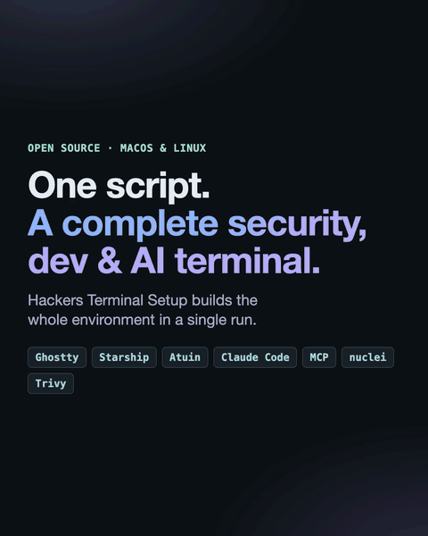

# Hackers Terminal Setup 2.1

[](https://github.com/jinnu92/Hackers-terminal-setup/actions/workflows/shellcheck.yml)
[](LICENSE)
[](https://lnkd.in/p/gfTJVKKD)
[](https://medium.com/@jinnu92/one-script-to-build-a-complete-security-dev-and-ai-terminal-df9806f71fba)

<p align="center">
  <a href="https://jinnu92.github.io/Hackers-terminal-setup/">
    
  </a>
</p>

A Bash installer for macOS and Linux that sets up a shell, terminal, development and AI-agent environment, plus an optional set of security-testing tools. It is a thin layer over other people's open-source projects: this repository installs and configures them, it does not build them. See [Acknowledgements](#acknowledgements) for who built what.

Scripts in this repository install packages and rewrite dotfiles. Read [Security and trust](#security-and-trust) before running it, and preview with `--dry-run` first.

> A Homebrew tap (`jinnu92/tap`) is planned but not published yet. Until it exists, use the install methods below.

---

## Contents

- [Live preview](#live-preview)
- [Quick start](#quick-start)
- [Command-line reference](#command-line-reference)
- [What is new in 2.1](#what-is-new-in-21)
- [Components](#components)
- [Customising your terminal](#customising-your-terminal)
- [MCP servers for Claude Code](#mcp-servers-for-claude-code)
- [Shell ergonomics](#shell-ergonomics)
- [System doctor](#system-doctor)
- [Pinned versions and what is not pinned](#pinned-versions-and-what-is-not-pinned)
- [Repository layout](#repository-layout)
- [Security and trust](#security-and-trust)
- [Acknowledgements](#acknowledgements)

---

## Live preview

An interactive browser page shows the prompt, welcome cockpit, Claude Code and MCP view, terminal configs, security tool output, the lifecycle commands and a profile builder that produces an install command. The terminal output on it is simulated; nothing runs.

**Live demo: https://jinnu92.github.io/Hackers-terminal-setup/**

Or open it locally:

```bash
open terminal_preview.html        # macOS
xdg-open terminal_preview.html    # Linux
```

---

## Quick start

### One-line install

```bash
# Interactive menu
curl -fsSL https://raw.githubusercontent.com/jinnu92/Hackers-terminal-setup/main/ter.sh | bash

# Non-interactive: pass flags after `-s --`
curl -fsSL https://raw.githubusercontent.com/jinnu92/Hackers-terminal-setup/main/ter.sh | bash -s -- --fonts --dev --mcp

# Preview what a selection would do, changing nothing
curl -fsSL https://raw.githubusercontent.com/jinnu92/Hackers-terminal-setup/main/ter.sh | bash -s -- --dry-run --all
```

### Download, read, then run

If you would rather read the script before executing it:

```bash
curl -fsSLO https://raw.githubusercontent.com/jinnu92/Hackers-terminal-setup/main/ter.sh
less ter.sh
bash ter.sh --dry-run --all     # preview
bash ter.sh                     # interactive menu
```

### From a clone

```bash
git clone https://github.com/jinnu92/Hackers-terminal-setup.git
cd Hackers-terminal-setup
./ter.sh --list                 # show components and their flags
./ter.sh                        # interactive menu
```

In the menu, choose components by number (for example `1 2 3 4 6 7`) or type `A` for everything.

---

## Command-line reference

`./ter.sh --help` is the source of truth. Selection flags map to the numbered components in [Components](#components).

```bash
./ter.sh --list                          # components: number, flag, name, contents
./ter.sh --version                       # print the version
./ter.sh --dry-run --all                 # preview everything, change nothing
./ter.sh -y --fonts --dev --mcp          # unattended install of a selection
./ter.sh --doctor                        # audit the current machine (read-only)
./ter.sh --doctor --json                 # same, machine-readable
```

Other options: `-y/--yes` (no prompts), `-a/--all`, `-n/--dry-run`, `-d/--doctor`, `-V/--version`, `-h/--help`. Unknown options are an error and nothing runs until the whole selection is valid. A bare `-y` with no component flags means "install everything".

---

## What is new in 2.1

### Preview, list, version

```bash
./ter.sh --list              # the numbered component table
./ter.sh --dry-run --core --mcp
./ter.sh --version           # Hackers Terminal Setup 2.1.1
```

`--dry-run` prints, per component, what it would install and which files it would write. It writes nothing, creates nothing and runs no package manager.

### Results table, log file, exit status

Each component runs independently. At the end the installer prints a results table (ok / failed / skipped per step), writes a log to `~/.local/state/hts/install.log`, and exits non-zero if any step failed, so it can be used in automation.

### Backups before any dotfile is rewritten

Every file the installer replaces is first copied to `~/.local/state/hts/backups/<timestamp>/`, and the copy is recorded in a manifest (`~/.local/state/hts/manifest.tsv`). This covers `~/.zshrc`, `~/.tmux.conf`, terminal configs, the Starship, Atuin and direnv configs, and so on.

### Lifecycle commands

These run on their own (no preflight, no component flags):

```bash
./ter.sh --status                 # installed components, tracked tools and files, backup runs, log/manifest paths
./ter.sh --restore                # restore the earliest backup of each file
./ter.sh --restore 20261122-101500   # restore the backups from one run
./ter.sh --dry-run --restore      # show what would be restored
./ter.sh --uninstall              # restore backups and remove files this tool created
./ter.sh --uninstall --purge-tools   # also remove tools recorded in the manifest
./ter.sh --update                 # check for a newer release; upgrade manifest-recorded tools
```

Details that matter:

- `--restore` backs up the current file before overwriting it, so a restore can itself be reversed. It refuses paths outside `$HOME` and directories.
- `--uninstall` restores backed-up dotfiles and removes files the tool created. It asks for confirmation (use `-y` to skip, `--dry-run` to preview). **Tools are not removed by default**, because the manifest cannot prove you do not depend on them; it prints the commands to remove them. `--purge-tools` removes the recorded tools through their package manager.
- **Not undone automatically:** a changed login shell (`chsh -s <previous shell>`), Homebrew itself, Oh My Zsh, third-party package repositories and signing keys that were added (for example under `/etc/apt/sources.list.d`), and the npm prefix setting (`npm config delete prefix`). `--uninstall` prints these.
- `--update` checks the latest GitHub release and tells you how to get it. For recorded tools it runs `brew upgrade`, `npm -g update` and `pipx upgrade`, and re-runs `go install <module>@latest` for Go tools, so Go tools move to their latest upstream version on update rather than the pinned one. Tools from `apt`, `dnf`, `pacman`, `zypper` and `cargo` are left to the system package manager.

### Doctor with JSON output

```bash
./ter.sh --doctor --json | jq '.totals, .ok'
```

One JSON document (components, config hygiene findings, state paths, totals, an `ok` boolean) with no banner. See [System doctor](#system-doctor).

### Go and Node policy

- **Go:** if no Go 1.25 or newer is found, Linux gets the official toolchain from go.dev at the version pinned in `lib/versions.sh`, verified against a SHA-256 digest and installed to `~/.local/share/go` without sudo. On macOS the installer uses Homebrew's `go`, which tracks the current release.
- **Node.js:** the installer wants Node 22 or newer. On Debian/Ubuntu and Fedora-family systems it uses the NodeSource LTS repository (the newest LTS line). On Arch and openSUSE it uses the distribution package. On macOS it uses Homebrew's `node` formula, which is the current release and is not guaranteed to be an LTS line. If a version manager (nvm, fnm, Volta) owns Node, the npm prefix is left alone.

---

## Components

Numbers and flags match `./ter.sh --list`. Rows marked `-` have a flag but no number.

| # | Flag | Component | What it installs or configures |
|---|------|-----------|--------------------------------|
| 1 | `--core` | Core terminal | Oh My Zsh, zsh-autosuggestions, zsh-syntax-highlighting, zsh-completions, Powerlevel10k, fzf, bat, eza, zoxide, git-delta, tmux, fd, ripgrep, tldr, lazygit, MesloLGS NF |
| 2 | `--fonts` | Hacker Fonts | Nerd Fonts: Meslo, JetBrains Mono, Fira Code, Hack, Cascadia |
| 3 | `--node` | Node.js & npm | Node.js (see policy above), npm with a non-root global prefix `~/.npm-global` |
| 4 | `--claude` | Claude Code CLI | Claude Code via Anthropic's native installer (stable channel). No Node.js needed. Shortcut: `ccode` |
| 5 | `--code` | VS Code & CLI | Visual Studio Code, `code` command on PATH |
| - | `--dev` | Developer stack | 3 + 4 + 5 |
| 6 | `--terminals` | GPU Terminals | Ghostty, WezTerm, Kitty, Alacritty with Catppuccin Mocha configs (per-platform matrix below) |
| 7 | `--shell-tools` | Shell History | Atuin, direnv, uv, btop, yazi, git-delta, eza, zoxide, ripgrep, fzf, bat, fd, Starship |
| 8 | `--mcp` | MCP Server Suite | Claude Code and Desktop MCP servers, MCP Inspector, semgrep, detect-secrets, `sec-mcp` |
| 9 | `--pentest` | Pentest tools | nmap, netcat, httpie, gobuster, hydra, sqlmap, masscan, tcpdump, john, hashcat, wireshark-cli (Linux), impacket, pwntools, scapy, NetExec, SecLists |
| - | `--seclists` | SecLists | SecLists wordlists to `~/pentest/wordlists` |
| 10 | `--bugbounty` | Bug bounty | subfinder, httpx, nuclei, katana, dnsx, interactsh-client, gau, hakrawler, waybackurls, amass, dalfox, ffuf, feroxbuster, nikto, mitmproxy, arjun, bbot, Caido CLI, Burp Suite (macOS cask) |
| 11 | `--ad-pivot` | Active Directory | Ligolo-ng, Chisel, NetExec, BloodHound.py, BloodHound CE ingestor and CE CLI launcher, Certipy, Responder |
| 12 | `--web-api` | Web & API Sec | Schemathesis, Kiterunner, Caido CLI, Arjun, ffuf, feroxbuster |
| 13 | `--cloud` (alias `--devsecops`) | Cloud & DevSecOps | AWS CLI, Azure CLI, gcloud, prowler, pacu, cloudfox, gitleaks, trufflehog, s3scanner, Trivy, Syft, Grype, Checkov, kubescape, kube-bench, osv-scanner |
| 14 | `--mobile` | Mobile & Reverse | jadx, Apktool, frida-tools, objection |
| 15 | `--ai` | AI / LLM sec | garak, llm, jwt_tool, promptfoo, Ollama |
| 16 | `--workflow` | Workflow tools | lazygit, jq, yq, gh, pandoc, xh, yazi, Obsidian (macOS cask) |
| 17 | `--dashboard` | Tactical Cockpit | Fastfetch and the welcome banner (`welcome.zsh`) |
| 18 | `--config` | Config files | `~/.zshrc`, `~/.tmux.conf`, `pentest.zsh`, `advanced_pentest.zsh`, `welcome.zsh` |
| 19 | `--doctor` | System Doctor | Read-only audit of installed tools and config |

kube-hunter was dropped (unmaintained upstream); kubescape, kube-bench and osv-scanner replace it. Some tools are only installed on certain platforms (for example Burp Suite and Obsidian only via macOS casks; wireshark-cli on Linux). `--dry-run` shows what applies on your machine.

### Terminal install matrix (`--terminals`)

| Terminal | macOS (cask) | apt | dnf | pacman | zypper |
|----------|--------------|-----|-----|--------|--------|
| Ghostty | yes | skipped (no official package) | skipped (no official package) | yes | no |
| WezTerm | yes | yes, via the upstream apt repository `apt.fury.io/wez` (added by the installer) | yes, via the upstream COPR `wezfurlong/wezterm-nightly` (nightly builds) | yes | no |
| Kitty | yes | yes | yes | yes | yes |
| Alacritty | skipped while the Homebrew cask is disabled | only if the release has the package (Debian 13+, Ubuntu 24.04+) | yes | yes | yes |

Other package managers: nothing is installed. On WSL and on headless Linux (no `DISPLAY` or `WAYLAND_DISPLAY`) no GUI terminal is installed at all. A terminal's config file is written only if that terminal is present.

---

## Customising your terminal

The welcome banner, tips and prompt can be changed without editing generated files.

Settings file: `~/.config/hts/config`

| Key | Values | Meaning |
|-----|--------|---------|
| `welcome` | `full` / `compact` / `off` | Size of the welcome banner shown in a new tab |
| `welcome_ip` | `show` / `hide` | Whether local IP addresses appear in the banner |
| `tips` | `on` / `off` | Rotating tip line in the banner |
| `prompt` | `p10k` / `starship` | Which prompt the generated `.zshrc` loads |

The `hts` command:

```bash
hts config                      # show current settings
hts config welcome compact      # set one key
hts config prompt starship
hts config reset                # back to defaults
```

Changes apply in the next terminal tab you open.

`hts doctor`, `hts status`, `hts update`, `hts uninstall`, `hts restore`, `hts list` and `hts version` run the installer's matching command (`--doctor`, `--status`, `--update`, `--uninstall`, `--restore`, `--list`, `--version`).

Your own shell additions go in `~/.zshrc.local`. The generated `.zshrc` sources it at the end, and the installer never touches it, so it survives re-runs, `--restore` and `--uninstall`.

---

## MCP servers for Claude Code

`--mcp` configures Model Context Protocol servers for Claude Code (user scope), Claude Desktop, and a project file at `~/pentest/.mcp.json`. All servers are pinned to specific versions (see the top of `lib/ai_mcp.sh`).

| Server | Source | When it is configured |
|--------|--------|-----------------------|
| `filesystem` | `@modelcontextprotocol/server-filesystem` (npm) | Always. Scoped to `~/workspace` and `~/pentest` only; the installer refuses `$HOME` or `/` |
| `memory` | `@modelcontextprotocol/server-memory` (npm) | Always |
| `fetch` | `mcp-server-fetch` (PyPI), run with `uvx` | When `uvx` is available |
| `github` | `github-mcp-server` release binary, SHA-256 verified | Only when `GITHUB_PERSONAL_ACCESS_TOKEN` is set in the environment |
| `brave-search` | `@brave/brave-search-mcp-server` (npm) | Only when `BRAVE_API_KEY` is set in the environment |

API keys are never written to the config files. Existing MCP config is merged: your other servers and settings are kept, and the previous file is backed up first. If a file cannot be merged safely, the entries are written to a side file for you to copy by hand.

`sec-mcp` (installed to `~/.local/bin`):

```bash
sec-mcp list      # servers actually present in Claude Desktop, ~/pentest/.mcp.json and Claude Code configs
sec-mcp inspect   # launch the MCP Inspector (pinned version)
sec-mcp setup     # re-run the MCP configuration (merges; keeps your other servers)
```

Claude Code itself is started with `claude`, or `ccode` (an alias defined in the generated `.zshrc`).

---

## Shell ergonomics

### Atuin: history with automatic secret scrubbing

- Replaces `.zsh_history` with Atuin's SQLite database; **Ctrl+R** opens fuzzy search with timestamps, exit codes and directory context.
- `secrets_filter = true` plus a `history_filter` list keep recognised secrets (cloud keys, GitHub and Slack tokens, `export ...KEY=` lines and similar) out of history.
- **The local history database is plain SQLite and is not encrypted at rest.** Only Atuin's optional sync is end-to-end encrypted, and sync is disabled in the generated config (`auto_sync = false`). What protects history at rest is full-disk encryption (FileVault on macOS, LUKS on Linux); the doctor checks whether it is enabled.

### direnv

Loads and unloads a directory's `.envrc` as you enter and leave it. The installer does not trust any directory automatically: review a `.envrc`, then run `direnv allow` in that directory. The doctor warns if a `[whitelist]` prefix list is present in `direnv.toml`.

### uv and uvx

Astral's `uv` replaces `pip`/`pipx`/`virtualenv` for many tasks, and `uvx` runs a Python tool without installing it globally:

```bash
uvx semgrep --config=auto
uvx mitmproxy
```

---

## System doctor

```bash
./ter.sh --doctor            # grouped text report
./ter.sh --doctor --json     # JSON
doctor                       # inside a configured shell (alias for sec-doctor)
```

The report is grouped by component (core, fonts, dev, terminals, shell tools, MCP, security suites, and so on), shows `ok / missing / optional / n/a` counts per group, then a "Config & hygiene" section, state paths and totals. Items are judged against what the manifest says you installed; with no manifest it reports informationally and exits 0. Hygiene checks include plaintext secrets in MCP config files, unpinned `@latest` MCP launchers, direnv auto-trust, the Atuin secrets filter, and whether disk encryption (FileVault / LUKS) is on.

---

## Pinned versions and what is not pinned

`lib/versions.sh` pins the binaries the installer downloads directly. Each is fetched, checked against a SHA-256 digest recorded in the repository, and installed only if the digest matches. Pinned and verified: Go toolchain, Ligolo-ng, Chisel, Kiterunner, jadx, Caido CLI, feroxbuster (Linux fallback), BloodHound CE CLI, yq, lazygit, xh, kubescape, kube-bench, osv-scanner (Linux), Nerd Fonts archives, MesloLGS NF, and the GitHub MCP server binary. ProjectDiscovery and other Go tools (subfinder, httpx, nuclei, katana, dnsx, interactsh-client, gau, hakrawler, waybackurls, amass) are pinned with `go install <module>@<version>`; Go's module checksum database verifies those, not a digest in this repository. ffuf, gobuster and dalfox use a package-manager package where one exists and otherwise the same pinned `go install`. SecLists, Responder, nikto and NetExec are git clones or installs pinned to release tags.

**Still not pinned or verified by this repository:**

- Packages from the system package manager (`brew`, `apt`, `dnf`, `pacman`, `zypper`): you get whatever the repository serves.
- Python tools installed with `pipx` or `uv tool` take the latest PyPI release: impacket, pwntools, scapy, arjun, bbot, schemathesis, certipy, BloodHound.py, frida-tools, objection, prowler, pacu, s3scanner, checkov, garak, llm, jwt_tool, semgrep, detect-secrets, and the others in those components.
- Go tools in the cloud component (cloudfox, gitleaks, trufflehog) are installed at `@latest`. `--update` also moves recorded Go tools to `@latest`.
- Third-party installer scripts, downloaded and run: Homebrew, Oh My Zsh, Claude Code (`claude.ai/install.sh`, stable channel), Starship, Ollama, Azure CLI (Debian/Ubuntu), NodeSource, Google Cloud SDK and the AWS CLI installer. The uv, Trivy, Syft and Grype installer URLs are pinned to a version tag, but the scripts are not digest-checked.
- Fastfetch on Ubuntu may come from a community PPA when there is no official package, and WezTerm may add the upstream apt repository or COPR (see Security and trust).

---

## Repository layout

```
Hackers-terminal-setup/
├── ter.sh                # Generated single-file installer (the file you curl). Built by bundle.sh
├── bundle.sh             # Concatenates lib/*.sh in dependency order into ter.sh
├── terminal_preview.html # Interactive demo page and profile builder
├── index.html            # GitHub Pages entry (redirects to terminal_preview.html)
└── lib/
    ├── common.sh         # Colours, logging, OS detection, download helpers, results table
    ├── versions.sh       # Pinned versions and SHA-256 digests
    ├── pkg_mgr.sh        # brew / apt / dnf / pacman / zypper wrapper
    ├── helpers.sh        # Go toolchain, pipx, go install helpers
    ├── preflight.sh      # Homebrew bootstrap, Oh My Zsh, disk space checks
    ├── fonts.sh          # Nerd Fonts
    ├── dev.sh            # Node.js, Claude Code, VS Code
    ├── terminals.sh      # Ghostty, WezTerm, Kitty, Alacritty and their configs
    ├── shell_tools.sh    # Atuin, direnv, uv, btop, yazi, delta, Starship
    ├── ad_pivoting.sh    # Active Directory and pivoting tools
    ├── web_api.sh        # Web and API security tools
    ├── cloud_devsec.sh   # Trivy, Syft, Grype, Checkov, kubescape, kube-bench, osv-scanner
    ├── mobile_re.sh      # jadx, Apktool, frida-tools, objection
    ├── pentest.sh        # Core pentest tools
    ├── bugbounty.sh      # Recon and bug bounty tools
    ├── cloud.sh          # Cloud provider CLIs and cloud security tools
    ├── ai_mcp.sh         # MCP suite, sec-mcp, AI/LLM security tools
    ├── workflow.sh       # lazygit, jq, yq, gh, pandoc, xh, yazi, Obsidian
    ├── dashboard.sh      # Fastfetch and the welcome banner
    ├── doctor.sh         # Diagnostic audit (text and JSON)
    ├── configs.sh        # Dotfile generators (.zshrc, .tmux.conf, ...)
    ├── lifecycle.sh      # --status, --restore, --uninstall, --update
    └── menu.sh           # Interactive menu, component table, argument parsing
```

`ter.sh` is a build artifact: it contains the text of every module. Edit `lib/*.sh`, then run `./bundle.sh` to regenerate it. When the script is run from a clone that still has `lib/` next to it, it sources the modules from `lib/`; when it is piped from `curl`, it runs the bundled copy and never reads `lib/` from the current directory.

---

## Security and trust

**What this script changes on your machine:**

- Installs packages through Homebrew (installing Homebrew itself if missing) or your Linux package manager, using `sudo` where needed.
- Installs Oh My Zsh and, through `--config`, rewrites `~/.zshrc`, `~/.tmux.conf` and shell helper files under `~/.oh-my-zsh/custom/`. It may set zsh as your login shell.
- Writes tool configs under `~/.config/` (terminals, Atuin, direnv, Starship, Fastfetch) and MCP configs (Claude Desktop, `~/pentest/.mcp.json`, Claude Code user scope).
- Creates `~/workspace` and `~/pentest`, `~/.local/bin`, `~/go`, `~/.npm-global`, and a state directory `~/.local/state/hts`.
- May add third-party repositories: the WezTerm apt repository or COPR, NodeSource, the Microsoft apt repository for the Azure CLI, and on Ubuntu a community PPA for Fastfetch when no official package exists. The installer prints a warning before adding one.
- Downloads and runs third-party installer scripts (listed above).

**Preview first:** `./ter.sh --dry-run --all` (or any selection) lists packages and files without changing anything.

**Undo:** every rewritten dotfile is backed up first. `./ter.sh --restore` puts backups back; `./ter.sh --uninstall` restores backups and removes files the tool created, and prints what it cannot undo (login shell, Homebrew, Oh My Zsh, added repositories). Add `--purge-tools` to remove recorded tools.

**Install paths:** the one-line `curl | bash` form is convenient but runs code you have not read. The alternative is to download `ter.sh`, read it, and run it locally; the `lib/` sources are in this repository.

**Authorized use only.** The offensive tools it installs (scanners, credential tools, pivoting, AD attack tooling) are for authorized security testing, lab environments and CTFs. You are responsible for having permission to test any system you point them at.

---

## Acknowledgements

This project installs and configures open-source software built by other people. None of it is written here. Credits are by project or organisation, grouped like the components. The listed projects are not affiliated with this project and do not endorse it.

**Shell, terminal and fonts**
[Oh My Zsh](https://ohmyz.sh/), [Powerlevel10k](https://github.com/romkatv/powerlevel10k) (Roman Perepelitsa), [zsh-users](https://github.com/zsh-users) (autosuggestions, syntax-highlighting, completions), [fzf](https://github.com/junegunn/fzf), [bat](https://github.com/sharkdp/bat) and [fd](https://github.com/sharkdp/fd), [eza](https://github.com/eza-community/eza), [zoxide](https://github.com/ajeetdsouza/zoxide), [delta](https://github.com/dandavison/delta), [tmux](https://github.com/tmux/tmux), [ripgrep](https://github.com/BurntSushi/ripgrep), [tldr-pages](https://tldr.sh/), [Nerd Fonts](https://www.nerdfonts.com/), [Catppuccin](https://catppuccin.com/) (Mocha theme colours).

**Terminals**
[Ghostty](https://ghostty.org/), [WezTerm](https://wezterm.org/), [Kitty](https://sw.kovidgoyal.net/kitty/), [Alacritty](https://alacritty.org/).

**Shell tools and development**
[Atuin](https://atuin.sh/), [direnv](https://direnv.net/), [Starship](https://starship.rs/), [Astral](https://astral.sh/) (uv, uvx), [btop](https://github.com/aristocratos/btop), [yazi](https://github.com/sxyazi/yazi), [Node.js](https://nodejs.org/), [Visual Studio Code](https://code.visualstudio.com/), [Fastfetch](https://github.com/fastfetch-cli/fastfetch), [lazygit](https://github.com/jesseduffield/lazygit), [jq](https://jqlang.org/), [yq](https://github.com/mikefarah/yq), [GitHub CLI](https://cli.github.com/), [pandoc](https://pandoc.org/), [xh](https://github.com/ducaale/xh), [Obsidian](https://obsidian.md/).

**AI agent and MCP**
[Anthropic](https://www.anthropic.com/) ([Claude Code](https://github.com/anthropics/claude-code) and the [Model Context Protocol](https://modelcontextprotocol.io/) with its [reference servers](https://github.com/modelcontextprotocol/servers): filesystem, memory, fetch, and the MCP Inspector), [GitHub](https://github.com/github/github-mcp-server) (GitHub MCP server), [Brave](https://github.com/brave/brave-search-mcp-server) (Brave Search MCP server), [Semgrep](https://semgrep.dev/), [detect-secrets](https://github.com/Yelp/detect-secrets) (Yelp).

**Pentest, recon and bug bounty**
[ProjectDiscovery](https://projectdiscovery.io/) (subfinder, httpx, nuclei, katana, dnsx, interactsh), the [Nmap project](https://nmap.org/), [sqlmap](https://sqlmap.org/), [THC-Hydra](https://github.com/vanhauser-thc/thc-hydra), [John the Ripper](https://www.openwall.com/john/) (Openwall), [hashcat](https://hashcat.net/), [gobuster](https://github.com/OJ/gobuster), [masscan](https://github.com/robertdavidgraham/masscan), [tcpdump](https://www.tcpdump.org/), [HTTPie](https://httpie.io/), [Daniel Miessler](https://github.com/danielmiessler/SecLists) (SecLists), [Fortra](https://github.com/fortra/impacket) (Impacket), [pwntools](https://github.com/Gallopsled/pwntools), [Scapy](https://scapy.net/), [gau](https://github.com/lc/gau), [hakrawler](https://github.com/hakluke/hakrawler), [waybackurls](https://github.com/tomnomnom/waybackurls), [OWASP Amass](https://github.com/owasp-amass/amass), [Dalfox](https://github.com/hahwul/dalfox), [ffuf](https://github.com/ffuf/ffuf), [feroxbuster](https://github.com/epi052/feroxbuster), [Nikto](https://github.com/sullo/nikto), [mitmproxy](https://mitmproxy.org/), [Arjun](https://github.com/s0md3v/Arjun), [Black Lantern Security](https://github.com/blacklanternsecurity/bbot) (bbot), [PortSwigger](https://portswigger.net/burp) (Burp Suite), [Caido](https://caido.io/).

**Active Directory and pivoting**
[Ligolo-ng](https://github.com/nicocha30/ligolo-ng), [Chisel](https://github.com/jpillora/chisel), [NetExec](https://github.com/Pennyw0rth/NetExec), [SpecterOps](https://github.com/SpecterOps/BloodHound) (BloodHound), [BloodHound.py](https://github.com/dirkjanm/BloodHound.py), [Certipy](https://github.com/ly4k/Certipy), [Responder](https://github.com/lgandx/Responder).

**Web and API security**
[Schemathesis](https://github.com/schemathesis/schemathesis), [Assetnote](https://github.com/assetnote/kiterunner) (Kiterunner).

**Cloud and DevSecOps**
[Aqua Security](https://github.com/aquasecurity) ([Trivy](https://github.com/aquasecurity/trivy), [kube-bench](https://github.com/aquasecurity/kube-bench)), [Anchore](https://github.com/anchore) ([Syft](https://github.com/anchore/syft), [Grype](https://github.com/anchore/grype)), [Checkov](https://github.com/bridgecrewio/checkov), [Kubescape](https://github.com/kubescape/kubescape), [Google](https://github.com/google/osv-scanner) (OSV-Scanner), [AWS CLI](https://github.com/aws/aws-cli), [Azure CLI](https://github.com/Azure/azure-cli), [Google Cloud CLI](https://cloud.google.com/sdk), [Prowler](https://github.com/prowler-cloud/prowler), [Pacu](https://github.com/RhinoSecurityLabs/pacu), [CloudFox](https://github.com/BishopFox/cloudfox), [Gitleaks](https://github.com/gitleaks/gitleaks), [TruffleHog](https://github.com/trufflesecurity/trufflehog), [S3Scanner](https://github.com/sa7mon/S3Scanner).

**Mobile and reverse engineering**
[jadx](https://github.com/skylot/jadx) (skylot), [Apktool](https://github.com/iBotPeaches/Apktool), [Frida](https://frida.re/), [objection](https://github.com/sensepost/objection).

**AI and LLM security**
[garak](https://github.com/NVIDIA/garak), [promptfoo](https://github.com/promptfoo/promptfoo), [llm](https://github.com/simonw/llm) (Simon Willison), [jwt_tool](https://github.com/ticarpi/jwt_tool), [Ollama](https://ollama.com/).

**Copied into this repository.** The Ghostty theme file written by `--terminals` (`~/.config/ghostty/themes/catppuccin-mocha`) uses the colour palette from [catppuccin/ghostty](https://github.com/catppuccin/ghostty), and the Kitty and Alacritty configs use Catppuccin Mocha colour values. Catppuccin is released under the MIT licence, Copyright (c) 2021 Catppuccin. Source: https://github.com/catppuccin.

---

## License

MIT. See [LICENSE](LICENSE). Third-party tools installed by this project keep their own licences.
